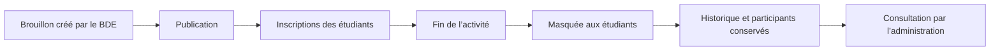

<div align="center">

# YouCast

### La plateforme communautaire du BDE YouCode

Découvrez les activités, rejoignez une équipe, participez aux défis et proposez vos idées — au même endroit.


[Présentation](#youcast) · [Installation](#installation-windows) · [Lancer le site](#lancer-le-site) · [Utilisation](#comment-utiliser-youcast) · [Tests](#vérification-et-tests)

</div>

---

## YouCast

YouCast est une application web pour le BDE YouCode. Les étudiants y trouvent les événements et challenges, s’inscrivent seuls ou en équipe, proposent de nouvelles idées et échangent en privé avec le BDE. Les administrateurs disposent d’un espace dédié pour gérer les activités et les inscriptions.

L’interface du site est en français. Le projet utilise Laravel, Blade, Tailwind CSS, Alpine.js et Vite.

## Parcours dans l’application

| Espace | Ce qu’on peut y faire |
| --- | --- |
| **Accueil** | Découvrir YouCast et accéder aux principales informations. |
| **Compte étudiant** | Créer son compte, gérer son profil, consulter son tableau de bord et ses inscriptions. |
| **Activités** | Rechercher des activités, consulter leurs informations et s’inscrire selon le format proposé. |
| **Équipes** | Créer une équipe, partager son code d’invitation, la rejoindre et l’inscrire avec son responsable. |
| **Idées** | Envoyer une proposition de challenge et suivre son traitement par le BDE. |
| **Messages** | Contacter le BDE dans une conversation privée. |
| **Administration** | Créer et publier des activités, gérer les idées, consulter les inscriptions et répondre aux messages. |

### Cycle d’une activité



Une activité terminée disparaît automatiquement des pages étudiantes après sa date de fin. Son activité, ses inscriptions et son historique restent conservés dans la base de données et visibles par l’administration.

## Prérequis

- Windows 10 ou 11
- PHP 8.2 ou plus, avec les extensions SQLite, Mbstring, OpenSSL, PDO, Tokenizer, XML, Ctype et Fileinfo
- [Composer](https://getcomposer.org/)
- [Node.js et npm](https://nodejs.org/)

## Installation Windows

Ouvre PowerShell dans le dossier du projet, puis installe les dépendances PHP et JavaScript :

```powershell
composer install
npm ci
```

Pour une **première installation seulement**, prépare la configuration locale et la base SQLite :

```powershell
if (-not (Test-Path .env)) {
    Copy-Item .env.example .env
    php artisan key:generate
}
if (-not (Test-Path database/database.sqlite)) { New-Item -ItemType File -Path database/database.sqlite | Out-Null }
php artisan migrate
```

`key:generate` sert à créer la clé lors de la première installation. Ne régénère pas la clé d’une installation existante : ça invaliderait les données chiffrées et les sessions en cours. Si `.env` existe déjà, conserve-le et ne le remplace pas par `.env.example`.

Compile ensuite les fichiers de l’interface :

```powershell
npm run build
```

### Données de démonstration facultatives

Pour remplir une base de développement avec quelques comptes et activités :

```powershell
php artisan db:seed
```

La base de démonstration crée `admin@youcode.local` et `learner@youcode.local`, avec le mot de passe `password`. Ces identifiants sont réservés au développement local : ne lance pas le seeder en production et remplace ou supprime ces comptes avant tout déploiement.

## Lancer le site

La commande de développement démarre le serveur Laravel, Vite et les outils locaux :

```powershell
composer run dev
```

Ouvre ensuite [http://127.0.0.1:8000](http://127.0.0.1:8000).

Tu peux aussi ouvrir deux fenêtres PowerShell dans le dossier du projet et lancer séparément :

```powershell
php artisan serve
```

```powershell
npm run dev
```

La seconde commande recharge les styles et les scripts pendant le développement. Si tu as déjà compilé l’interface avec `npm run build`, elle peut être servie depuis les fichiers compilés sans le serveur Vite.

## Comment utiliser YouCast

### Étudiant

1. Crée un compte depuis **Inscription** puis connecte-toi.
2. Ouvre **Activités** pour trouver un événement ou un challenge.
3. Inscris-toi directement pour une activité individuelle.
4. Pour un challenge d’équipe, crée une équipe ou rejoins-en une avec le code reçu. Le responsable inscrit ensuite l’équipe.
5. Consulte tes inscriptions et tes idées depuis le tableau de bord.
6. Utilise **Messages** pour contacter le BDE en privé.

Les pages d’activités sont réservées aux membres connectés. Les activités terminées sont masquées automatiquement aux étudiants, mais restent disponibles dans l’historique de l’administration.

### Administrateur BDE

Un utilisateur doit d’abord avoir un compte. Depuis PowerShell, une personne de confiance qui a accès au projet peut lui donner le rôle administrateur :

```powershell
php artisan youcast:promote-admin adresse@example.com
```

Connecte-toi ensuite avec ce compte. L’espace d’administration permet de créer un brouillon, le publier, gérer les idées, voir les noms des participants inscrits et répondre aux conversations. La liste nominative des participants est visible uniquement dans l’administration.

## Vérification et tests

La suite complète utilise une base SQLite en mémoire et ne modifie pas la base locale du site :

```powershell
php artisan test
```

Pour compiler les ressources de production :

```powershell
npm run build
```

## Technologies

| Partie | Outils |
| --- | --- |
| Serveur | PHP 8.2+, Laravel 12 |
| Interface | Blade, Tailwind CSS 3, Alpine.js |
| Compilation des ressources | Vite, Node.js, npm |
| Stockage local par défaut | SQLite |
| Tests | PHPUnit via `php artisan test` |

## Documentation du projet

- [Contexte technique pour les contributeurs](AI_CONTEXT.md)
- [Rapport de sécurité](BACKEND_SECURITY_AUDIT.md)
- [Rapport d’implémentation backend](BACKEND_IMPLEMENTATION_REPORT.md)
- [Checklist de sécurité](SECURITY_CHECKLIST.md)
- [Rapport du design](DESIGN_IMPLEMENTATION_REPORT.md)

## Notes de sécurité

- Ne partage pas le fichier `.env` et ne l’ajoute jamais au contrôle de versions.
- N’utilise pas les comptes de démonstration en production.
- Configure un service SMTP avant d’envoyer de vrais e-mails ; le transport `log` est réservé au développement.
- Pour un déploiement, utilise HTTPS, désactive le mode debug et configure les valeurs de production dans l’environnement du serveur.
